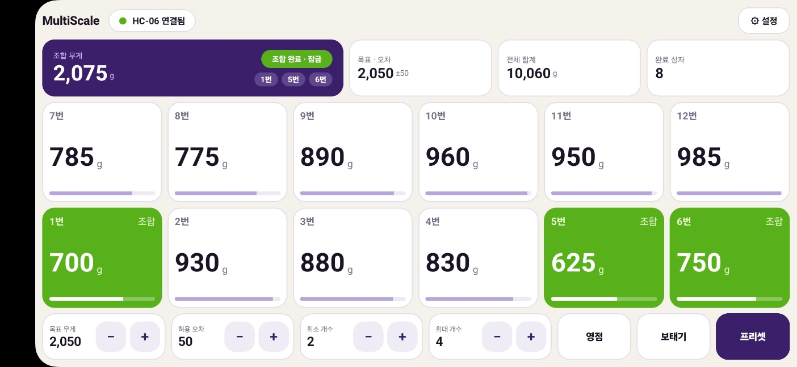
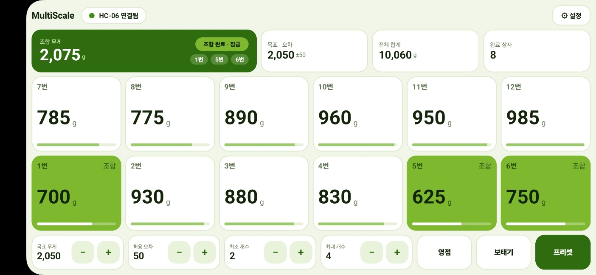
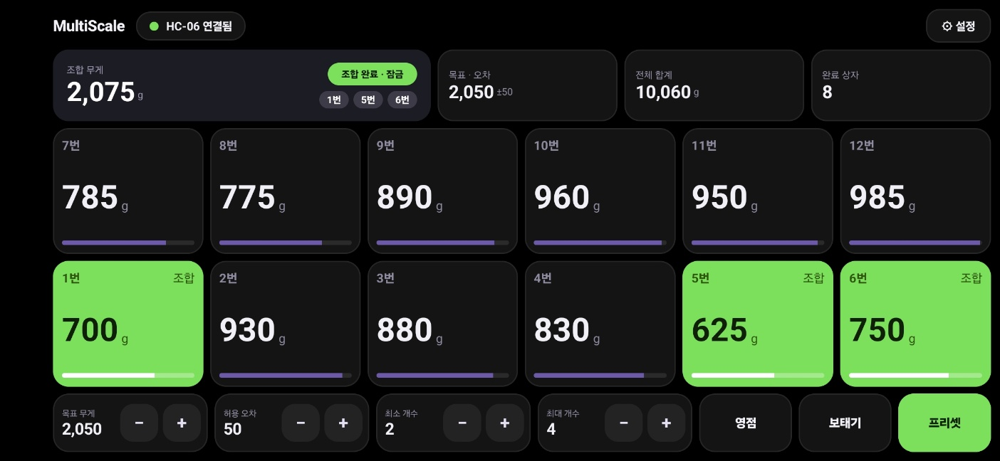

# 멀티스케일 (MultiScale)

> 누구나 **쉽고 저렴하게, 시중에서 구할 수 있는 부품만으로** 만드는 DIY 멀티채널 저울.

여러 개의 저울(로드셀 + HX711)에서 올라오는 무게를 블루투스로 받아, 목표 무게에 가장 가까운 **최적 조합**을 찾아 보여주는 안드로이드 앱과 펌웨어 모음입니다.
포도 선별(박스 담기)용으로 만든 라즈베리파이판 [`grape-sorter`](https://github.com/kjt7942/grape-sorter)의 2세대 프로젝트입니다.

| 포도 (밝게) | 청포도 (밝게) | 블랙 (OLED) |
|---|---|---|
|  |  |  |

## 주요 기능

- **최적 조합 탐색**: 목표 무게·허용 오차·최소/최대 개수 안에서 가장 가까운 저울 조합을 찾습니다. (기존 `main.py` 알고리즘과 결과가 같도록 검증)
- **조합 잠금**: 찾은 조합은 저울에서 포도를 집어 올리는 동안 흔들리지 않게 고정합니다. 조합된 저울이 전부 비워지면 박스 완성으로 세고 새 조합을 찾습니다.
- **보태기 모드**: 지정한 저울(박스 올리는 저울)이 모두 올라와 안정된 뒤에만 조합합니다.
- **DIY 배열**: 저울 개수(2~24), 한 줄에 놓을 저울 수, 번호 순서, 화면에서 자리 바꾸기를 앱 설정에서 바꿉니다. 현재 하드웨어(아랫줄 1~6, 윗줄 7~12)가 기본값입니다.
- **테마 5종**: 포도(밝게) · 밤 포도(어둡게) · 청포도(밝게) · 블랙(OLED) · 고대비(작업장).
- **화면 방향 선택**: 가로 / 세로 / 자동 회전. 무게 막대는 설정에서 켜고 끌 수 있습니다.
- **프리셋 8개**: 짧게 눌러 불러오기, 2초 길게 눌러 저장.
- **자동 업데이트**: GitHub Releases 의 최신 APK 를 내려받아 설치합니다.
- **테스트 모드 / 시뮬레이터**: 저울 없이 가짜 무게로 화면과 동작을 확인할 수 있습니다.

## 설치 (갤럭시)

1. 폰 브라우저에서 이 저장소 **Releases → 최신 `MultiScale-x.y.z.apk`** 를 내려받습니다.
2. 설치 시 "이 출처 허용"을 켜고 설치합니다.
3. 폰 설정에서 HC-06 을 먼저 블루투스 페어링합니다(비밀번호 1234 또는 0000).
4. 앱 우측 위 **설정 → 연결·정보 → 블루투스 연결**에서 기기를 고릅니다.

### 자동 업데이트
앱이 켜질 때와 6시간마다 최신 릴리스를 확인해, 새 버전이 있으면 내려받고 작업 중(조합 잠금)이 아닐 때 설치를 시작합니다.
설치 뒤 자동으로 다시 실행되려면 **다른 앱 위에 표시** 권한이 필요합니다(설정 → 연결·정보 → 자동 재실행). 안드로이드 규칙상 완전 무확인 설치는 보장되지 않습니다.
앱이 비정상 종료되면 다음 실행 때 오류 내용을 보여주는 화면이 먼저 나옵니다.

## 화면 설정

설정(⚙) 버튼에서 다음을 바꿉니다.

| 탭 | 항목 |
|---|---|
| 화면·배열 | 화면 방향, 테마, 무게 막대 켜기/끄기, 저울 개수, 한 줄에 놓을 저울 수, 번호 순서(아랫줄부터/윗줄부터), 화면에서 자리 바꾸기, 보태기 박스 저울 선택 |
| 프리셋 | 8개 슬롯 불러오기/저장/비우기 |
| 연결·정보 | 블루투스 연결, 테스트 모드, 조합 잠금, 앱·펌웨어 버전, 업데이트 확인 |

- 저울 개수·줄 수를 바꾸면 자리가 기본 배열로 초기화됩니다.
- 펌웨어가 보내는 저울 수가 앱 설정과 다르면 화면 위에 "N개로 맞추기" 안내가 나옵니다.

## 통신 프로토콜 (블루투스 클래식 SPP, 줄바꿈 `\n`)

| 방향 | 내용 |
|---|---|
| 장치 → 앱 | `<w1,w2,…,wN>` 저울 N개의 무게(g). 읽기 오류는 `ERR` |
| 장치 → 앱 | `[VER] 버전`, `[TARE] …`, `[SYSTEM] 영점 조절 완료` |
| 앱 → 장치 | `<TARE>` 영점, `<VER>` 버전 요청, `<1,3,5>` 켜야 할 LED 번호(1부터) |
| 앱 → 시뮬레이터 | `<E1,2>` 해당 저울을 0g 으로 비움, `<F1,2>` 500~1000g 랜덤으로 채움 (테스트용) |

짧은 `ERR` 는 직전 정상값을 유지하고, 연속으로 이어질 때만 에러로 표시합니다.

## 펌웨어

- [`firmware/uno_simulator`](firmware/uno_simulator/uno_simulator.ino): 아두이노 우노 + HC-06(소프트웨어 시리얼 2·3번, 9600). 저울 없이 12채널 랜덤 무게를 0.3초마다 보내고 `<E>`, `<F>`, `<TARE>`, `<VER>` 명령을 처리합니다. 상단의 `N` 상수로 채널 수를 바꿀 수 있습니다. USB 시리얼(115200)에는 받은 명령(`RX …`)이 출력됩니다.

## 하드웨어 설계 방향 (검토 결과)

목표는 전용 PCB 없이 **시중 부품 + 점퍼선/만능기판**으로 만드는 것입니다.

- **권장 보드: 일반 크기 ESP32 개발보드**(ESP32-WROOM-32 / DevKit V1, 30·38핀). 블루투스 클래식(SPP)이 내장되어 HC-06 이 필요 없고 핀이 넉넉합니다.
  - 피해야 할 것: ESP32-C3/S3/S2/C6(블루투스 클래식 미지원 또는 없음), ESP8266, ESP32-CAM, 핀이 적은 미니 보드(12채널+LED에는 부족).
- **Uno 호환보드**는 8채널 이하 미니 키트에 적합합니다. 핀은 약 16개(HC-06 제외)라 HX711 의 DT/SCK 를 따로 쓰면 8개, SCK 를 공통으로 묶으면 DT 만 따로 두어 이론상 15개까지 가능하지만 직접 읽는 코드가 필요하고 LED 핀이 부족합니다.
- **HX711 은 3.3V 로 구동**합니다. VCC 를 ESP32 의 3V3 핀에 연결하면 DT 출력도 3.3V 라서 직결해도 안전합니다. **5V 로 구동하면 DT 가 5V 가 되어 ESP32 핀이 손상될 수 있습니다.**
- **전원**: 12채널 기준 HX711+로드셀 약 60~130mA, 블루투스 동작 중 ESP32 약 100~130mA. 5V 1A 이상 충전기를 쓰고, 전원선에 100~470µF 전해콘덴서를 달아 송신 순간의 전압 강하(재부팅)를 막습니다. 로드셀은 1kΩ급이 전류가 적습니다.
- **LED(선택)**: 조합된 3~4개만 켜지므로 전류는 작습니다. 핀 절약은 PCF8574(8핀)/MCP23017(16핀) I2C 모듈이 납땜 없이 쉽습니다. LED 는 저항 1kΩ 안팎, 3.3V 로 구동합니다. LED 없이 앱 화면의 초록색 표시만으로 쓸 수도 있습니다.
- ESP32 펌웨어(N채널 동시 읽기), 부품 목록(BOM)·배선표는 **아직 작성 전**입니다.

## 개발

- Kotlin 1.9 / Jetpack Compose / AGP 8.5, minSdk 26, 갤럭시 S25 · 갤럭시 탭에서 확인.
- `SorterEngine`(조합·잠금 로직), `Combination`(조합 탐색), `Protocol`(패킷 파서), `Layout`/`Theme`(배열·테마), `SorterViewModel`, `MainScreen`, `Updater`(자동 업데이트), `BluetoothLink`.
- 단위 테스트는 조합 알고리즘, 프로토콜, 엔진(잠금·보충·보태기), 배열을 다룹니다. 이 환경에서는 로컬 Gradle 빌드가 안 되어 CI(GitHub Actions)에서 테스트와 빌드를 합니다.

### 배포 방법
`version.txt` 의 숫자(예: 0.2.2)를 올리고 main 에 푸시하면 됩니다. 태그는 Actions 가 자동 생성하고, 테스트 → 서명 → APK 빌드 → Release 업로드까지 합니다. 버전 코드는 `X*10000 + Y*100 + Z` 입니다.

**최초 1회 설정** (Settings → Secrets and variables → Actions): `scripts/make_keystore.sh` 실행 후 `KEYSTORE_BASE64`, `KEYSTORE_PASSWORD`, `KEY_ALIAS`, `KEY_PASSWORD` 4개를 등록하세요.
**release.jks 는 커밋 금지, 별도 백업 필수**(분실 시 업데이트 불가).

## 변경 기록

| 버전 | 내용 |
|---|---|
| 0.2.1 | 조합 무게·합계 숫자 확대와 우측 정렬, 조합 번호 크게 표시, 저울 막대 표시 옵션(기본 끔) |
| 0.2.0 | 패드 B 스타일 새 화면. 저울 개수·열 수·자리 바꾸기, 테마 5종, 화면 방향 선택, 펌웨어 채널 수 감지 |
| 0.1.10 | 펌웨어 버전 요청 재시도, 마지막 명령 표시, 스케치 디버그 출력 |
| 0.1.9 | 시작 시 크래시 수정(프로퍼티 초기화 순서) |
| 0.1.8 | 비정상 종료 원인 기록·표시 화면 |
| 0.1.x | 시뮬레이션 테스트 환경(저울 눌러 비우기/채우기, 박스 완성 시 자동 보충), 보태기 모드 대기 규칙, 자동 업데이트·설치 후 재실행 |
| 0.1.0 | grape-sorter UI·알고리즘을 안드로이드로 이식, 블루투스(HC-06) 연결 |

## 앞으로 할 일

- ESP32 펌웨어(N채널 동시 읽기, 영점·캘리브레이션, LED 출력)
- 부품 목록(BOM), 배선표, 조립 가이드
- 채널 수·핀 설정을 앱에서 안내하는 DIY 설정 마법사
- 앱 아이콘 (현재는 기존 포도 아이콘 유지)
